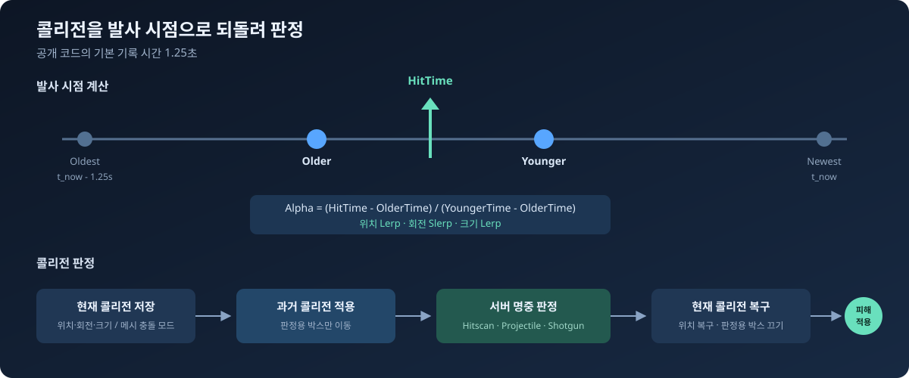
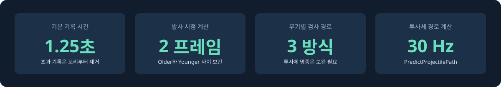
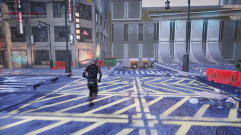
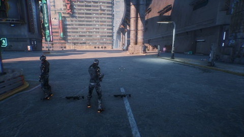
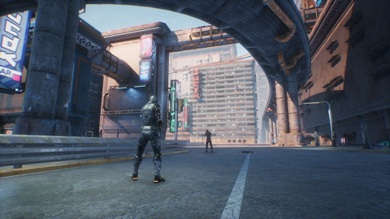

# 멀티플레이 TPS 지연 보상

서버 사이드 리와인드로 캐릭터의 콜리전을 발사 시점으로 되돌려 명중을 판정했습니다.

멀티플레이 TPS에서 클라이언트와 서버의 시간 차이를 다룬 프로젝트입니다. 공개 코드는 리와인드 흐름을 Unreal Engine 5.5 기준으로 다시 정리한 버전입니다.

[플레이 영상](https://youtu.be/QH26UeeRWrM) · [리와인드 코드](Source/NetworkShooter/Private/Network/RewindHistoryComponent.cpp)

<p>
  
  
  
  
</p>



## 담당 파트

- 클라이언트와 서버 시간 동기화
- 캐릭터 콜리전 프레임 기록
- Server-Side Rewind 명중 판정
- 히트스캔·샷건 명중 검사와 투사체 경로 계산
- 서버 권한 피해 처리

## 서버에 도착한 시각과 발사한 시각을 구분했습니다

클라이언트 화면에서는 맞았지만 서버에서는 빗나가는 경우가 있었습니다. 명중 요청이 서버에 도착했을 때는 상대 캐릭터가 이미 이동한 뒤였기 때문입니다.

서버가 캐릭터 콜리전을 기록하고, 요청에 담긴 시각의 위치를 다시 계산하도록 했습니다. 계산한 위치로 판정용 콜리전을 옮겨 명중을 확인한 뒤 현재 위치로 복구하고 판정용 충돌을 껐습니다. 공개 코드의 기록 시간 기본값은 `1.25초`입니다.

## 리와인드 처리

1. 서버가 콜리전의 위치, 회전, 크기를 매 프레임 기록합니다.
2. 발사 시각 앞뒤의 `Older`, `Younger` 프레임을 찾습니다.
3. 위치와 크기는 `Lerp`, 회전은 `Slerp`로 보간합니다.
4. 현재 콜리전을 저장하고 판정용 콜리전을 과거 위치로 옮깁니다.
5. 무기 유형에 맞게 명중을 판정합니다.
6. 판정이 끝나면 콜리전의 위치·회전·크기를 복구하고 판정용 박스를 끕니다. 캐릭터 메시의 충돌 모드는 저장해 둔 값으로 복구합니다.

최신 프레임은 이중 연결 리스트의 앞에 넣고, 기록 시간을 넘긴 프레임은 뒤에서 제거했습니다. 요청 시각이 저장된 가장 오래된 프레임보다 앞서거나 최신 프레임보다 뒤면 판정하지 않습니다.

| 단계 | 함수 | 처리 |
| --- | --- | --- |
| 기록 | `SaveCurrentFrame` | 콜리전 상태 저장, 지난 프레임 제거 |
| 탐색 | `TrySampleFrame` | 발사 시각 앞뒤 프레임 탐색 |
| 보간 | `InterpolateFrames` | 발사 시점의 콜리전 계산 |
| 적용 | `ApplyFrame` | 콜리전을 과거 위치로 이동 |
| 판정 | `ConfirmHitscan/Projectile/Shotgun` | 무기별 명중 검사 |
| 복구 | `RestoreFrame` | 위치·회전·크기 복구, 판정용 박스 비활성화 |

## 무기별 판정

| 무기 | 공개 코드의 처리 | 기본 설정값 |
| --- | --- | ---: |
| 히트스캔 | 과거 콜리전에 Line Trace, 명중 지점까지 지형 가림 확인 | 최대 20,000 uu |
| 투사체 | 초기 속도로 비행 경로 계산, 경로 구간별 지형 가림 확인 | 30 Hz, 최대 30,000 uu/s |
| 샷건 | 펠릿별 Line Trace 후 피해 합산, 한 발에 최대 4명 | 최대 16개 |

클라이언트는 대상, 추적 시작점과 끝점 또는 초기 속도, 요청 시각을 보냅니다. 피해량은 서버 설정으로 계산했습니다. 서버는 판정 전에 다음을 확인합니다.

| 검사 | 기준 |
| --- | --- |
| 요청 시각 | 서버가 잰 왕복 지연 + 0.15초 이내만 되돌림 (최대 1.25초) |
| 발사 시작점 | 서버의 눈 위치에서 150 uu + 요청 지연 동안 이동한 거리 이내 |
| 발사 방향 | 서버 조준 방향과 30도 이내 (샷건 펠릿은 15도 추가) |
| 발사 간격 | 평균 0.1초 간격, 프레임 오차는 간격의 15%까지 허용 |
| 지형 | 리와인드 채널은 지형을 무시하므로 `Visibility` 채널로 벽 너머 명중을 거부 |
| 생존 | 사수나 대상의 체력이 0이면 판정하지 않음 |
| 같은 발사 | 같은 시각의 보고는 같은 무기 종류일 때만 여러 대상으로 인정 |

탄약 검사는 무기·인벤토리 코드가 없어 이 저장소에 포함되어 있지 않습니다. 지형 가림 검사는 현재 프레임의 지형과 다른 캐릭터 위치를 기준으로 합니다.

## 시간 동기화

왕복 지연의 절반을 편도 지연으로 가정해 서버 시각과 클라이언트 시각의 차이를 계산했습니다. 첫 측정값은 바로 적용하고, 이후 `5초`마다 받은 값은 `0.15` 비율로 보정했습니다. 공개 코드에는 시간 계산 컴포넌트까지 들어 있으며, 발사 입력에서 이 값을 사용하는 연결은 포함되어 있지 않습니다.

```text
EstimatedServerTime = ServerReceiveTime + RTT / 2
```

## 공개 코드의 기본값



기록 시간과 시뮬레이션 주기는 설정값입니다. 지연 보상률이나 성능을 측정한 결과는 아닙니다. 투사체 판정에서 남은 수정 사항은 [처리 흐름과 확인 범위](docs/ARCHITECTURE.md#확인-범위)에 적었습니다.

## 코드

- [`RewindHistoryComponent.cpp`](Source/NetworkShooter/Private/Network/RewindHistoryComponent.cpp): 프레임 기록, 보간, 콜리전 이동과 복구
- [`NetworkClockComponent.cpp`](Source/NetworkShooter/Private/Network/NetworkClockComponent.cpp): 서버 시간 계산
- [`ValidatedWeaponComponent.cpp`](Source/NetworkShooter/Private/Combat/ValidatedWeaponComponent.cpp): 요청 검사와 서버 피해 적용
- [`ARCHITECTURE.md`](docs/ARCHITECTURE.md): 처리 순서와 예외 조건

## 플레이 화면

| 이동 | 멀티플레이 | 전투 |
| --- | --- | --- |
|  |  |  |
